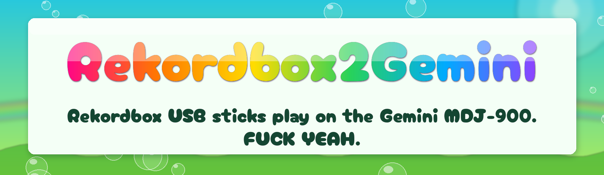
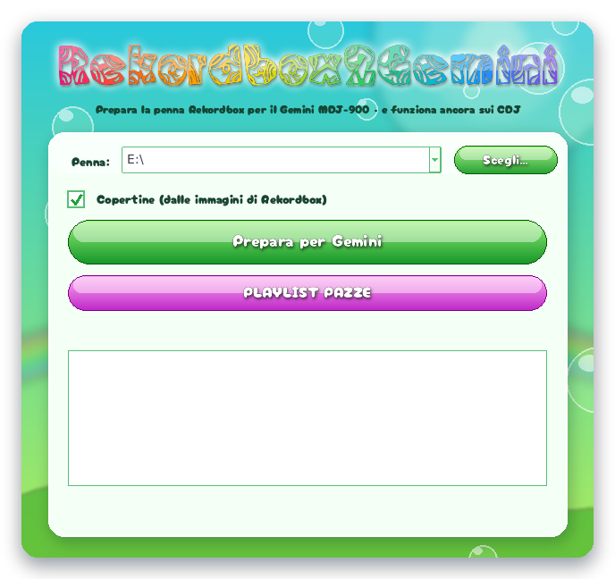
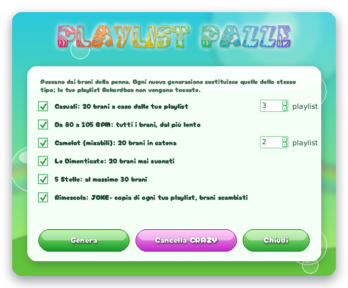
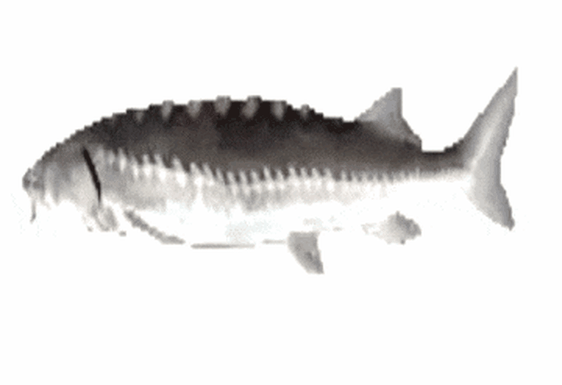

<a href="README.md">🇮🇹 Italiano</a> · <b>🇬🇧 English</b>

  
  
  

<b>🏷️ Version 1.0</b> · October 2026 · free 🌈 
Click and the zip downloads · Windows 10 and 11 (64-bit) · Apple Silicon and Intel Macs 
<b>❓ <a href="#faq">Frequently asked questions</a></b>

> [!WARNING]
> **Mac version not tested yet.** The Mac versions were built and checked automatically, but nobody has
> tried them on a real Mac yet. If you do, tell us how it went by opening an [*Issue*](../../issues):
> good or bad, it helps a lot. 🙏

---

<h2 align="center"></h2>

I bought a Gemini MDJ-900. 
I believed in it. I played on it. I put my name on it. 
 
Then Gemini walked away. 
No updates. No support. No answers. 
Last firmware: 6.10. The end. 
 
The player still works. <b>It's the brand that died.</b>

<h3 align="center">🔥 ABANDONED, YES. DEFEATED, NEVER. 🔥 🖕 IF YOU WON'T UPDATE IT, I WILL. 🐟</h3>

---

<h2 align="center"></h2>

One Rekordbox stick. Works on the CDJs. Works on the Gemini. <b>💥 NO MORE TWO STICKS. 💥</b>

📂 <b>Playlists</b>, in the same order as Rekordbox 
🎯 <b>Cues, hot cues A–H, loops</b> 
🏷️ <b>Title, artist, BPM, artwork</b> 
🌊 <b>Ready-made waveforms</b>: the Gemini stops analyzing 
🌀 <b>CRAZY PLAYLISTS</b> (see below) 
🛡️ <code>PIONEER/</code> and your music are <b>never touched</b>

---

<h2 align="center"></h2>

<b>🎛️ Rekordbox → 💾 USB stick → 🐟 Rekordbox2Gemini → 🎚️ Gemini MDJ-900</b>

<b>1️⃣</b> You export from Rekordbox to the stick, like you always do for the CDJs 
<b>2️⃣</b> Rekordbox2Gemini reads the export: tracks, playlists, cues, waveforms and artwork 
<b>3️⃣</b> It translates them into the Gemini's language and writes them in the <code>GEMINI</code> folder, next to <code>PIONEER</code> 
<b>4️⃣</b> The Gemini opens the stick and finds everything ready, as if V-Case had made it 
<b>5️⃣</b> The CDJs keep reading <code>PIONEER</code>: <b>one stick, two worlds</b> 🌍🌍

⬅️ The main window: pick the stick, press <b>Prepara per Gemini</b>, done. ➡️ CRAZY PLAYLISTS: tick what you want, press <b>Genera</b> ("Generate").

---

<h2 align="center"></h2>

<b>1️⃣</b> Copy the program to the stick, next to <code>PIONEER</code> 
<b>2️⃣</b> Double-click → press <b>Prepara per Gemini</b> ("Prepare for Gemini") → watch the 👌 fill up 
<b>3️⃣</b> Stick into the Gemini → <b>Browse → Playlists</b> → 🎧

<h3 align="center">🔁 EXPORTED AGAIN? PRESS AGAIN. THAT'S IT. 🔁</h3>

The program speaks Italian 🇮🇹. You'll manage.

<b>🔓 First launch: computer complaining? Click here</b>

 

The program isn't signed, so the first time the system asks for confirmation:
- **Windows**: *More info* → *Run anyway*.
- **Mac**: open it once, then *System Settings* → *Privacy & Security* → **Open Anyway**.
  If it asks for access to "removable volumes", allow it.

---

<h2 align="center"></h2>

Press <b>PLAYLIST PAZZE</b> and the program invents <code>CRAZY-…</code> playlists from the tracks on your stick.

🎲 <b>Random</b> — 20 random tracks, as many playlists as you want 
🐢 <b>80–105 BPM</b> — from slowest to fastest 
🎡 <b>Camelot</b> — a chain of 20 tracks with compatible keys 
👻 <b>The Forgotten</b> — 20 tracks you've never played 
⭐ <b>5 Stars</b> — the best of the best 
🃏 <b>JOKE-</b> — shuffles tracks between your playlists. <b>Do it to a friend.</b>

🧹 <b>Cancella CRAZY</b> ("Delete CRAZY") removes <b>only</b> the <code>CRAZY-…</code> and <code>JOKE-…</code> playlists made by the program. 
Your Rekordbox playlists, tracks, cues and waveforms <b>all stay where they are</b>. You can generate new ones anytime.

Only mp3 and wav: the Gemini reads nothing else in playlists

---

<h2 align="center"></h2>

### 🏷️ 1.0 · October 2026 · the first one

The first public version. Everything above, for the first time:

- 📂 playlists, cues, hot cues A–H, loops, title, artist, BPM and artwork from Rekordbox to the Gemini
- 🌊 converted waveforms: the Gemini stops analyzing tracks
- 🌀 CRAZY PLAYLISTS, JOKE- ones for your friends included
- 💻 Windows 10 and 11
- 🍏 Apple Silicon and Intel Macs, **not tested yet** (see above)

<b>🧪 What was tested</b>

 

- Real Rekordbox sticks, playlists up to 270 tracks: ok.
- Waveforms, overview bar and hot cues on the Gemini MDJ-900 (firmware 6.10): spot on.
- The `PIONEER/` folder stays identical: the same stick keeps working on the CDJs.

---

<h2 align="center"></h2>

<b>WE ALL LOSE TOGETHER.</b> 🎺 The message tells you what to do. 
Details are in <code>Rekordbox2Gemini-log.txt</code> on the stick: open an <a href="../../issues"><i>Issue</i></a> and attach it.

---

<h2 align="center"></h2>

### ❓ Can the Gemini MDJ-900 read Rekordbox USB sticks?
Not on its own: it wants sticks prepared with V-Case. With Rekordbox2Gemini, yes: run the program on the stick exported from Rekordbox and within a minute the Gemini sees playlists, cues and waveforms.

### ❓ Can I use the same stick on Pioneer CDJs and on the Gemini?
Yes, that's exactly why it exists. The program adds a `GEMINI` folder next to `PIONEER` and touches nothing else. The stick works on the CDJs just like before.

### ❓ Do I still need V-Case?
No, never again. Rekordbox2Gemini writes the same files V-Case used to write, starting from what you already prepared in Rekordbox.

### ❓ Why does the Gemini take so long to load tracks?
Because it analyzes every track the first time you open it. With Rekordbox2Gemini the waveforms come ready-made from Rekordbox, so it doesn't need to analyze anymore. The only exception is tracks from very old Rekordbox exports, without detailed waveforms.

### ❓ Do I have to redo everything every time I update the stick from Rekordbox?
No: export again from Rekordbox, double-click the program, **Prepara per Gemini**. Playlists deleted or renamed in Rekordbox get updated on the Gemini too.

### ❓ I have FLAC, AIFF or M4A tracks: do they work?
The program converts them like the others, but the Gemini only loads **mp3 and wav** from playlists. It's a limit of the player. If you want those tracks in the Gemini's playlists, export them as mp3 or wav.

### ❓ Can I lose my music or ruin the stick?
The program never touches the audio files or the `PIONEER` folder: it only writes in the `GEMINI` folder. Keeping a backup of your music is always a good idea, but the program is built not to touch it.

### ❓ I already have playlists made with V-Case on the stick: will I lose them?
Yes, careful: playlists in the `GEMINI` folder that don't come from Rekordbox get removed. The only exception is the program's own CRAZY and JOKE playlists. If you still need them, recreate them in Rekordbox before converting.

### ❓ How many playlists can I have?
The Gemini reads **100** at most. If you have more, the program warns you; your Rekordbox playlists always come before the CRAZY PLAYLISTS. Rekordbox folders become playlists named `Folder - Playlist`.

### ❓ Does it work with other Gemini players or another firmware?
It has only been tested on the **MDJ-900 with firmware 6.10**, the last one released. If you have another model that used V-Case, you can try it with no risk for the CDJs, because `PIONEER` is never touched. Then tell us how it went with an [*Issue*](../../issues).

---

<h2 align="center">☠️ THE GEMINI IS DEAD. LONG LIVE THE GEMINI. 🐟</h2>

Free as in free: <a href="LICENZA.txt">free sturgeon license</a> 🌈 Fonts: Cherry Bomb (satsuyako, Marc Foley, SIL OFL 1.1), Swirled (Brian Kent, Aenigma Fonts), Noto Color Emoji (Google, SIL OFL 1.1). 
Gemini, MDJ-900, V-Case, Rekordbox and CDJ are trademarks of their respective owners; this project is not affiliated with them, also because I hate them.

