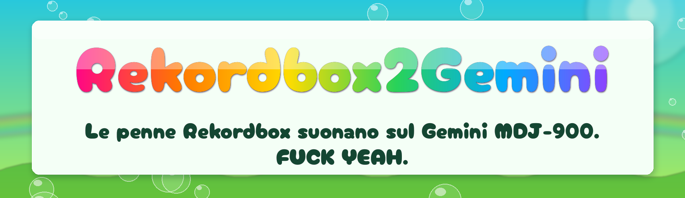

<b>🇮🇹 Italiano</b> · <a href="README.en.md">🇬🇧 English</a>

  
  
  

<b>🏷️ Versione 1.0</b> · ottobre 2026 · gratis 🌈 
Clicca e lo zip si scarica · Windows 10 e 11 (64 bit) · Mac Apple Silicon e Intel 
<b>❓ <a href="#faq">Domande frequenti</a></b>

> [!WARNING]
> **Versione Mac non ancora testata.** Le versioni per Mac sono state costruite e controllate in automatico,
> ma nessuno le ha ancora provate su un Mac vero. Se la provi, raccontaci com'è andata aprendo una
> [*Issue*](../../issues): bene o male, ci aiuti tantissimo. 🙏

---

<h2 align="center"></h2>

Ho comprato un Gemini MDJ-900. 
Ci ho creduto. Ci ho suonato. Ci ho messo la faccia. 
 
Poi Gemini se n'è andato. 
Nessun aggiornamento. Nessun supporto. Nessuna risposta. 
Ultimo firmware: 6.10. Fine. 
 
Il lettore funziona ancora. <b>È il marchio che si è spento.</b>

<h3 align="center">🔥 ABBANDONATI SÌ. SCONFITTI MAI. 🔥 🖕 SE NON LO AGGIORNI TU, LO AGGIORNO IO. 🐟</h3>

---

<h2 align="center"></h2>

Una penna Rekordbox. Va sui CDJ. Va sul Gemini. <b>💥 FINE DELLE DUE PENNE. 💥</b>

📂 <b>Playlist</b>, nello stesso ordine di Rekordbox 
🎯 <b>Cue, hot cue A–H, loop</b> 
🏷️ <b>Titolo, artista, BPM, copertine</b> 
🌊 <b>Waveform pronte</b>: il Gemini non analizza più niente 
🌀 <b>PLAYLIST PAZZE</b> (vedi sotto) 
🛡️ <code>PIONEER/</code> e la musica <b>non vengono toccati</b>

---

<h2 align="center"></h2>

<b>🎛️ Rekordbox → 💾 penna USB → 🐟 Rekordbox2Gemini → 🎚️ Gemini MDJ-900</b>

<b>1️⃣</b> Esporti da Rekordbox sulla penna, come fai sempre per i CDJ 
<b>2️⃣</b> Rekordbox2Gemini legge l'export: brani, playlist, cue, waveform e copertine 
<b>3️⃣</b> Li traduce nella lingua del Gemini e li scrive nella cartella <code>GEMINI</code>, accanto a <code>PIONEER</code> 
<b>4️⃣</b> Il Gemini apre la penna e trova tutto pronto, come se l'avesse fatta V-Case 
<b>5️⃣</b> I CDJ continuano a leggere <code>PIONEER</code>: <b>stessa penna, due mondi</b> 🌍🌍

⬅️ La finestra principale: scegli la penna, premi <b>Prepara per Gemini</b>, fatto. ➡️ PLAYLIST PAZZE: spunta quello che vuoi, premi <b>Genera</b>.

---

<h2 align="center"></h2>

<b>1️⃣</b> Copia il programma sulla penna, accanto a <code>PIONEER</code> 
<b>2️⃣</b> Doppio clic → premi <b>Prepara per Gemini</b> → guarda le 👌 riempirsi 
<b>3️⃣</b> Penna nel Gemini → <b>Browse → Playlists</b> → 🎧

<h3 align="center">🔁 RIESPORTI? RIPREMI. TUTTO QUI. 🔁</h3>

<b>🔓 Prima apertura: il computer fa storie? Clicca qui</b>

 

Il programma non è firmato, quindi la prima volta il sistema chiede conferma:
- **Windows**: *Ulteriori informazioni* → *Esegui comunque*.
- **Mac**: aprilo una volta, poi *Impostazioni di Sistema* → *Privacy e sicurezza* → **Apri comunque**.
  Se chiede l'accesso ai "volumi rimovibili", consenti.

---

<h2 align="center"></h2>

Premi <b>PLAYLIST PAZZE</b> e il programma inventa playlist <code>CRAZY-…</code> con i brani della tua penna.

🎲 <b>Casuali</b> — 20 brani a caso, quante playlist vuoi 
🐢 <b>80–105 BPM</b> — dal più lento al più veloce 
🎡 <b>Camelot</b> — 20 brani in catena con tonalità compatibili 
👻 <b>Le Dimenticate</b> — 20 brani mai suonati 
⭐ <b>5 Stelle</b> — il meglio del meglio 
🃏 <b>JOKE-</b> — mescola i brani tra le tue playlist. <b>Fallo a un amico.</b>

🧹 <b>Cancella CRAZY</b> toglie dalla penna <b>solo</b> le playlist <code>CRAZY-…</code> e <code>JOKE-…</code> create dal programma. 
Le tue playlist Rekordbox, i brani, i cue e le waveform <b>restano tutti dove sono</b>. Puoi rigenerarle quando vuoi.

Solo mp3 e wav: il Gemini non legge altro nelle playlist

---

<h2 align="center"></h2>

### 🏷️ 1.0 · ottobre 2026 · la prima

La prima versione pubblica. Tutto quello che c'è sopra, per la prima volta:

- 📂 playlist, cue, hot cue A–H, loop, titolo, artista, BPM e copertine da Rekordbox al Gemini
- 🌊 waveform convertite: il Gemini non analizza più i brani
- 🌀 PLAYLIST PAZZE, comprese le JOKE- da fare agli amici
- 💻 Windows 10 e 11
- 🍏 Mac Apple Silicon e Intel, **non ancora testati** (vedi sopra)

<b>🧪 Cosa è stato provato</b>

 

- Penne Rekordbox vere, playlist fino a 270 brani: ok.
- Waveform, barra panoramica e hot cue sul Gemini MDJ-900 (firmware 6.10): precisi.
- La cartella `PIONEER/` resta identica: la stessa penna continua ad andare sui CDJ.

---

<h2 align="center"></h2>

<b>WE ALL LOSE TOGETHER.</b> 🎺 Il messaggio ti dice cosa fare. 
Dettagli in <code>Rekordbox2Gemini-log.txt</code> sulla penna: apri una <a href="../../issues"><i>Issue</i></a> e allegalo.

---

<h2 align="center"></h2>

### ❓ Il Gemini MDJ-900 legge le penne Rekordbox?
Da solo no: vuole penne preparate con V-Case. Con Rekordbox2Gemini sì: lanci il programma sulla penna esportata da Rekordbox e in un minuto il Gemini vede playlist, cue e waveform.

### ❓ Posso usare la stessa penna sui CDJ Pioneer e sul Gemini?
Sì, ed è proprio il motivo per cui esiste. Il programma aggiunge una cartella `GEMINI` accanto a `PIONEER` e non tocca nient'altro. Sui CDJ la penna funziona come prima.

### ❓ Devo ancora usare V-Case?
No, mai più. Rekordbox2Gemini scrive gli stessi file che scriveva V-Case, partendo da quello che hai già preparato in Rekordbox.

### ❓ Perché il Gemini ci mette tanto a caricare i brani?
Perché analizza ogni brano la prima volta che lo apri. Con Rekordbox2Gemini le waveform arrivano già pronte da Rekordbox, quindi non deve più analizzare. L'unica eccezione sono i brani di export Rekordbox molto vecchi, senza waveform dettagliata.

### ❓ Ogni volta che aggiorno la penna da Rekordbox devo rifare tutto?
No: riesporti da Rekordbox, doppio clic sul programma, **Prepara per Gemini**. Le playlist cancellate o rinominate in Rekordbox vengono aggiornate anche sul Gemini.

### ❓ Ho brani in FLAC, AIFF o M4A: funzionano?
Il programma li converte come gli altri, ma il Gemini dalle playlist carica solo **mp3 e wav**. È un limite del lettore. Se vuoi quei brani nelle playlist del Gemini, esportali in mp3 o wav.

### ❓ Posso perdere la mia musica o rovinare la penna?
Il programma non tocca mai i file audio né la cartella `PIONEER`: scrive solo nella cartella `GEMINI`. Fare una copia della musica è sempre una buona idea, ma il programma è fatto per non toccarla.

### ❓ Ho già delle playlist fatte con V-Case sulla penna: le perdo?
Sì, attenzione: le playlist nella cartella `GEMINI` che non vengono da Rekordbox vengono tolte. L'unica eccezione sono le CRAZY e le JOKE del programma. Se ti servono ancora, ricreale in Rekordbox prima di convertire.

### ❓ Quante playlist posso avere?
Il Gemini ne legge al massimo **100**. Se ne hai di più, il programma ti avvisa; le tue playlist Rekordbox hanno sempre la precedenza sulle PLAYLIST PAZZE. Le cartelle di Rekordbox diventano playlist con il nome `Cartella - Playlist`.

### ❓ Funziona con altri lettori Gemini o con un altro firmware?
È stato provato solo sull'**MDJ-900 con firmware 6.10**, l'ultimo uscito. Se hai un altro modello che usava V-Case, puoi provarlo senza rischi per i CDJ, perché `PIONEER` non viene toccata. Poi raccontaci com'è andata con una [*Issue*](../../issues).

---

<h2 align="center">☠️ IL GEMINI È MORTO. VIVA IL GEMINI. 🐟</h2>

Gratis e libero: <a href="LICENZA.txt">licenza dello storione libero</a> 🌈 Font: Cherry Bomb (satsuyako, Marc Foley, SIL OFL 1.1), Swirled (Brian Kent, Aenigma Fonts), Noto Color Emoji (Google, SIL OFL 1.1). 
Gemini, MDJ-900, V-Case, Rekordbox e CDJ sono marchi dei rispettivi proprietari; questo progetto non è collegato a loro anche perché li odio.

